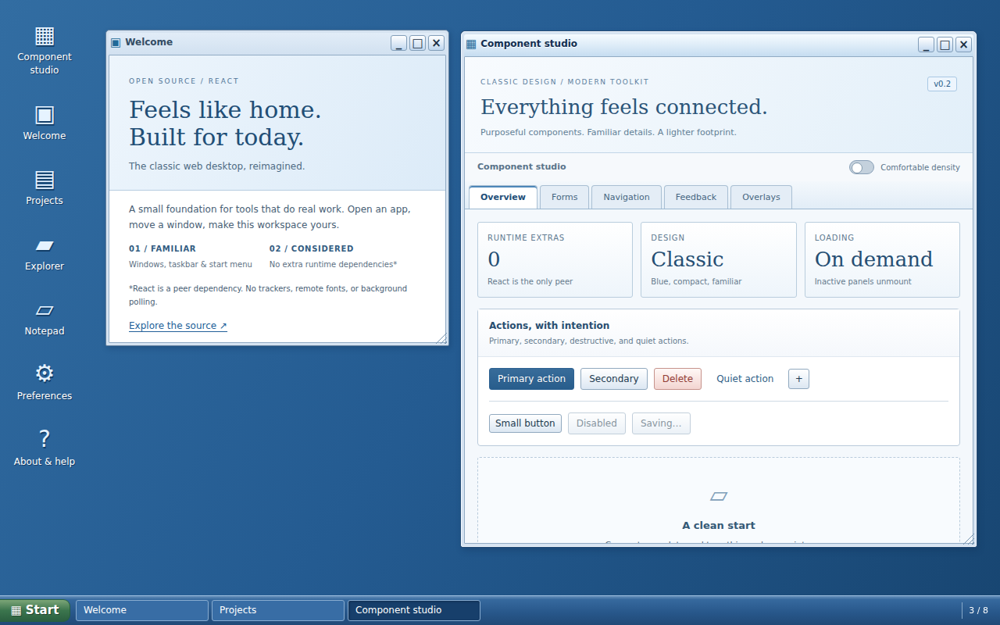

# Classic Web Desktop

An original, compact React desktop shell inspired by the classic blue web desktop era. Built by **Gobinath Palanisamy** for developers who want reusable windows, a taskbar, a launcher, and simple application components.

**Early release · v0.1.0 · MIT** — not affiliated with Sencha or Ext JS. No Ext JS code, logos, or images are included.



## Try it locally

Node.js 24 LTS recommended (development only; end users do not need Node).

```sh
npm ci
npm run check
npm run preview
```

Open http://127.0.0.1:4173. The build creates both the library (`dist/`) and a static demo (`site/`).

The configured GitHub Pages destination is https://gobinathp.github.io/classic-web-desktop/ — it becomes available after Pages is enabled and the deployment succeeds.

## Use in your project

The npm name `@gobinathp/classic-web-desktop` is **proposed, not yet published or ownership-verified**. Until publishing is configured, build from this repository and create a tarball:

```sh
npm ci
npm pack
# In your React project:
npm install /path/to/gobinathp-classic-web-desktop-0.1.0.tgz
```

```tsx
import { Desktop, Panel } from '@gobinathp/classic-web-desktop';
import type { DesktopApp } from '@gobinathp/classic-web-desktop';
import '@gobinathp/classic-web-desktop/styles.css';

// Keep definitions stable: module scope, or useMemo if they depend on props.
const apps: DesktopApp[] = [{
  id: 'hello',
  title: 'Hello',
  icon: '▣',
  initialSize: { width: 420, height: 300 },
  render: ({ close }) => (
    <Panel title="Your application">
      <p>Replace this content with your own React component.</p>
      <button onClick={close}>Done</button>
    </Panel>
  ),
}];

export default function App() {
  return <Desktop apps={apps} initialOpen={['hello']} maxWindows={6}
    style={{ height: '100dvh' }} />;
}
```

For Next.js, import the desktop from a client component (`'use client'`). React is a peer dependency; the host supplies its existing React installation. ReactDOM is required by the demo, not by the library. ESM, CommonJS, declarations, and a separate stylesheet are supplied. Importing components does not automatically inject CSS.

## Included components

| Export | Purpose |
| --- | --- |
| `Desktop` | Shortcut launcher, Start panel, taskbar, focus order, draggable/resizable windows |
| `Button` | Classic button styling with standard button props |
| `Panel` | Titled content section |
| `Toolbar` | Labeled action group |
| `DataGrid<T>` | Semantic, paginated table; up to 100 rendered rows per page |

Demo apps: Welcome, Projects, Explorer, Notepad, Preferences, and About. The Explorer uses native disclosure controls. This is a desktop shell, not a replacement for all Ext JS widgets or a full operating system.

### Desktop API

| Prop | Default | Behavior |
| --- | --- | --- |
| `apps` | required | Stable array of trusted React app definitions; unique nonempty IDs |
| `initialOpen` | `[]` | IDs opened once after the container is measured |
| `maxWindows` | `8` | Open-window cap, constrained to 1–32 |
| `label` | `Classic desktop` | Accessible region label |
| `className`, `style` | optional | Desktop container customization; provide a height |
| `onWindowsChange` | optional | Window-state notification; no persistence is performed |

An app has `id`, `title`, `render(context)`, optional `icon`, `initialSize`, `initialPosition`, and `keepAlive`. The render context provides `close()` and `minimize()`. A window only mounts when opened. **Minimize unmounts its contents by default**, releasing DOM and component effects; local state will reset on restore. Set `keepAlive: true` to preserve contents at additional memory/CPU cost. Closing always unmounts. To preserve user data efficiently, lift it into host-owned state. Removing an app or lowering the cap closes excess windows without a save prompt; handle unsaved data in your host.

`render` is not a hook component: return `<MyApp />` and put hooks inside `MyApp`. A render error shows a generic fallback; this is not isolation from malicious code.

### DataGrid API

Pass `rows`, `columns: { key, title, render(row) }[]`, `rowKey(row)`, `caption`, and optional `pageSize` (20 by default). Pagination limits mounted rows, not the memory of the input array. For large datasets, fetch/filter data on your server or in the host rather than passing millions of records.

### Keyboard and touch

- Tab to shortcuts, task buttons, and title controls; activate with Enter/Space.
- Alt + arrows moves the focused window; Alt + Shift + arrows resizes.
- Escape cancels a drag or closes the launcher. Title buttons provide alternatives where an OS intercepts shortcuts.
- Double-click the title bar to maximize/restore. Touch pointers can drag the title bar and resize grip.
- Nonmodal windows allow normal Tab navigation; focus is not trapped.

## Small-device and memory policy

No additional runtime packages beyond the React peer. No polling, telemetry, external images, webfonts, animation loops, blur effects, or automatic storage. Pointer movement changes only window geometry and schedules at most one animation frame; React state is committed at the end of a gesture. Listener/observer/frame cleanup is explicit. Z order is a bounded array rather than an ever-increasing counter.

The target is modest hardware running a maintained browser, **not every historical computer or browser**. ES2020, Pointer Events, CSS custom properties, and modern React are required; IE is unsupported. The demo targets Chromium, Firefox, and Safari, but see [validation](docs/VALIDATION.md) for what was actually tested. Touch hit targets are enlarged, and windows clamp to their container. Phone use is functional but the workspace is primarily designed for desktops/tablets.

Run `npm run check:size` for compressed transfer sizes. **Download size is not RAM consumption.** Total memory depends on the browser, React, the app components, data, and active windows. No fixed RAM or universal-device guarantee is made. See [performance](docs/PERFORMANCE.md).

## Security

See [SECURITY.md](SECURITY.md). The library does not interpret HTML strings, execute scripts from configuration, fetch data, store secrets, or provide authentication. All app render functions run with the host page's privileges. Never use this shell as a sandbox for untrusted plugins.

The demo includes a restrictive meta CSP with script execution limited to same-origin files. Dynamic geometry needs inline styles, so `style-src` permits them; scripts do not use `unsafe-inline` or `unsafe-eval`. A production host should set CSP and anti-framing rules in HTTP headers. GitHub Pages cannot provide arbitrary security response headers.

## Checks and contributing

```sh
npm run check
npx playwright install chromium
npm run test:browser
npm audit
npm pack --dry-run
```

See [CONTRIBUTING.md](CONTRIBUTING.md), [release setup](docs/RELEASING.md), and [validation](docs/VALIDATION.md). Keep runtime dependencies minimal, test window lifecycle changes, and keep gzipped library JS under 12 KB and CSS under 6 KB. Open a pull request for changes.
